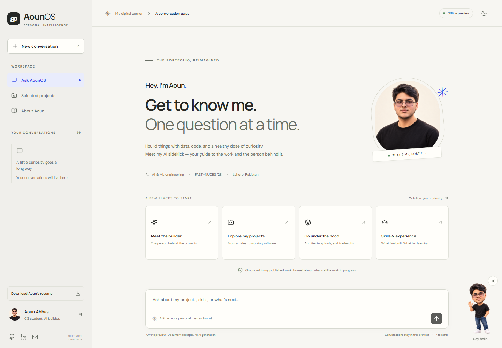

# AounOS

**A conversation with my work.** A personal AI portfolio assistant for Aoun Abbas: computer science student, curious builder, and aspiring AI engineer.

Ask about projects, technical decisions, skills, and the learning journey. AounOS retrieves evidence from a curated public Markdown knowledge base and streams a response with inspectable reference sources.



## Hosting

Deployed on **Vercel** for React and **Render** for FastAPI. Chroma runs inside the Render service, restored from a versioned public embedding snapshot at startup. No separate database subscription is required. The free Render plan can sleep when idle; waking it introduces a delay.

**Live app:** [aoun-abbas-ai.vercel.app](https://aoun-abbas-ai.vercel.app) · **Backend readiness:** [aounos-api.onrender.com/api/ready](https://aounos-api.onrender.com/api/ready) · **CI:** [GitHub Actions](https://github.com/aounkazmi-dev/Aoun-AI/actions)

Hosted streaming, sources, resume download, mobile layout, and browser-history persistence were verified on October 24, 2026. See [deployment instructions](docs/deployment.md) and [verification results and limitations](docs/verification.md).

### Where conversations are stored

Chat history is saved in the visitor's browser `localStorage` under `aounos.conversations.v1` (up to 30 conversations and 100 messages per conversation). It survives refreshes, but does not sync across devices, browsers, or site domains. Clearing site data removes it. Visitors can export or delete conversations. The backend does not store chats; Chroma stores public portfolio knowledge only. Live requests send the current question and up to six recent messages to the backend/provider.

## What is implemented

- React/TypeScript chat interface, responsive navigation, light/dark themes, illustrated avatar, animated corner companion, project explorer, full resume download, and profile page.
- Streaming text, safe Markdown, visible source excerpts, stop/retry, copy, and Markdown export.
- Browser-local history with rename/delete/search (up to 30 conversations, 100 messages each).
- FastAPI with validated requests, bounded body size, per-process request/concurrency limits, readiness checks, and structured SSE events.
- Gemini embeddings, normalized vectors, persistent Chroma cosine retrieval, explicit index compatibility checks, and atomic index activation.
- Configurable Gemini/Groq generation with fallback **only before the first output**. Auto mode prefers Groq when configured to avoid observed Gemini timeouts.
- Unit/integration/browser tests and a 20-case evaluation dataset.
- An explicit offline preview that returns document excerpts through lexical lookup. It is not AI generation and is labeled throughout the UI.

This is Aoun's personal portfolio project. Knowledge documents contain reported project facts, not an independent audit of every linked repository. Live answer quality must be evaluated with configured provider access.

## Quick start

Requires Python 3.11–3.13 and Node 22. Run from the repository root:

```powershell
python -m venv .venv
.\.venv\Scripts\python.exe -m pip install -r requirements-dev.lock
Copy-Item backend/env.example .env
cd frontend
npm ci
npm run build
cd ..
```

On Linux/macOS, use `.venv/bin/python` instead of `.venv\Scripts\python.exe` and `cp` instead of `Copy-Item`.

### Preview without credentials

```powershell
$env:DEMO_MODE = "true"
.\.venv\Scripts\python.exe -m uvicorn backend.api:app --host 127.0.0.1 --port 8000
```

Open **http://127.0.0.1:8000**. In bash, prefix the server command with `DEMO_MODE=true`.

On Windows after setup, the shortcut is `powershell -ExecutionPolicy Bypass -File scripts/start.ps1 -Demo`.

### Enable live AI

1. Set `GEMINI_API_KEY` in the root `.env`. Set `GROQ_API_KEY` for fast generation (recommended from local live tests). Without it, generation uses Gemini. `PRIMARY_PROVIDER` accepts `auto`, `groq`, or `gemini`. Never place keys in frontend variables or commit `.env`.
2. Set `DEMO_MODE=false`. Remove any shell override (`Remove-Item Env:DEMO_MODE` in PowerShell).
3. Build the index and start the server:

```powershell
.\.venv\Scripts\python.exe -m backend.ingest --dry-run
.\.venv\Scripts\python.exe -m backend.ingest
.\.venv\Scripts\python.exe -m uvicorn backend.api:app --host 127.0.0.1 --port 8000 --no-proxy-headers
```

Ingestion and live chat make external API requests and may incur provider charges. `/api/ready` returns 503 until the key and compatible index are present. It does not make a paid provider probe. Gemini embedding availability remains required even when Groq is configured.

### Frontend development

Run the API on port 8000, then `cd frontend && npm run dev`. Vite proxies `/api` to the backend. Local and Docker builds can serve both from one origin. Vercel uses the public `VITE_API_BASE_URL` to reach Render; provider keys stay exclusively on the backend.

### Terminal

```text
python -m backend.chat_cli --demo
python -m backend.chat_cli --debug
```

Use module commands from the repository root. The previous `python backend/chat_cli.py` invocation is replaced by this explicit package layout.

## Architecture

```mermaid
flowchart LR
  Markdown[Public Markdown] --> Ingest[Chunk + fingerprint]
  Ingest --> Embed[Gemini document embeddings]
  Embed --> Chroma[Versioned Chroma collection]
  Browser[React browser] --> API[FastAPI validation]
  API --> Query[Gemini query embedding]
  Query --> Chroma
  Chroma --> Prompt[Policy + profile + retrieved sources + bounded history]
  Prompt --> Primary[Configured primary: Groq or Gemini]
  Primary --> SSE[SSE sources/token/done/error]
  Primary -. pre-output failure .-> Fallback[Other provider]
  Fallback --> SSE
  SSE --> Browser
```



See [architecture and decisions](docs/architecture.md), [deployment](docs/deployment.md), and [evaluation](docs/evaluation.md).

## Verification

```text
python -m pytest -q
python -m backend.run_eval --mode lexical
cd frontend
npm test
npm run build
npm run test:e2e
```

Browser tests use installed Chrome on Windows. On Linux/macOS, first run `npx playwright install chromium`. Tests start an isolated offline server on port 8001. The Python tests use deterministic fake embeddings with a real temporary Chroma database; they never require API keys.

For live evaluation after ingestion:

```text
python -m backend.run_eval --mode semantic
python -m backend.run_eval --mode answers
```

## Privacy and limitations

- Only documents explicitly marked `visibility: public` are indexed. Private fields should never be put in public knowledge; field filtering is defense in depth, not a general PII detector.
- Messages are stored in this browser. Live questions, relevant knowledge, and bounded history are sent to Google and potentially Groq. The application does not persist chats on the server.
- Prompt constraints and citations reduce ambiguity; they do not guarantee grounded or injection-proof answers.
- Sources shown are available evidence, not claim-by-claim verification. The assistant does not browse links.
- The cosine threshold is provisional. Calibrate it using semantic evaluation before making accuracy claims.
- Rate limits are per process/IP, not distributed abuse protection. Deploy behind HTTPS with explicit trusted proxy configuration and provider spend limits.
- No accounts, cross-device history, autonomous agents, document uploads, or voice cloning are implemented.

## Repository map

```text
backend/          Configuration, ingestion, retrieval, providers, API, CLI
knowledge/        Curated public profile and project evidence
frontend/         React application and browser tests
tests/            Python tests, including real Chroma integration
evaluation/       Versioned cases; generated reports are ignored
docs/             Decisions, deployment, evaluation, and screenshots
```

The illustrated avatar was generated from Aoun's supplied photo using ImageGen. See [asset provenance](docs/avatar.md). Personal portrait and profile content should not be reused as another person's identity.
